# PYNE Language Support for VS Code

<div align="center">
  
</div>

**VS Code language support** for **`.pyne`** / **`.pine`** sources — syntax highlighting, diagnostics, autocomplete, hover, signature help, semantic tokens, formatting, Convert to v6, document links, inlay hints, and more. Powered by **[PYNE](https://hoox.sh/pyne)** (`hoox-pyne`).

Part of the **[HOOX](https://hoox.sh) open trading stack** — sister products: **[AXIS](https://hoox.sh/axis)** (charting PWA) and **[HOOX](https://hoox.sh)** (edge execution).

> Independent, unofficial extension. **Not** affiliated with, endorsed by, or sponsored by TradingView, Inc.  
> Pine Script™ and TradingView® are trademarks of TradingView, Inc.

This repo contains the **VS Code client only**. The language server (`pyne-lsp`), parser, runtime, and Pro API live in [hoox-sh/pyne](https://github.com/hoox-sh/pyne). The extension ships no server — it launches the one installed in your Python environment.

## Install

### From the Marketplace

Search **PYNE** in the VS Code Extensions view, or install the id directly:

```bash
code --install-extension hoox-sh.pyne
```

Also on [Open VSX](https://open-vsx.org/extension/hoox-sh/pyne) (VSCodium, Gitpod, code-server).

### From a VSIX

```bash
npm ci
npm run package
code --install-extension pyne-vscode-*.vsix
```

Versioned `pyne-vscode-<version>.vsix` files attach to [GitHub Releases](https://github.com/hoox-sh/pyne-lsp-vsce/releases). Site download: [hoox.sh/pyne-vscode.vsix](https://hoox.sh/pyne-vscode.vsix) (unversioned alias).

> The VSIX is **self-contained** (esbuild bundles `vscode-languageclient`). You still need the **language server** on the machine — see below.

## Install language server (required for LSP)

```bash
pip install "hoox-pyne[lsp]"
```

Confirm the preferred console script:

```bash
pyne-lsp --help
# alias still works: pynescript-lsp --help
# module form: python3 -m pynescript.langserver
```

### Automatic install from the extension

When the server can't be found, the extension offers to install it for you:

- **Default:** a one-time prompt with **Install now** / **Later** / **Don't ask again**.
- **Silent:** set `pynescript.install.autoInstall` to `true` to install without prompting.
- **Manual:** run **PYNE: Install Language Server** any time.

It resolves a Python interpreter (`pynescript.install.python` → `pynescript.lsp.python` → `python3` → `python` → `py`), requires Python ≥ 3.10 and pip, then runs:

```bash
<python> -m pip install --upgrade --disable-pip-version-check "hoox-pyne[lsp]"
```

Output streams to the **PYNE Language Server** channel; on success the client restarts. On Debian/Ubuntu and other PEP 668 (externally managed) Python installs, the extension automatically creates an isolated virtualenv under its storage (or at `pynescript.install.venv`) and installs there, then remembers that interpreter via `pynescript.install.python`. Set `pynescript.install.createVenv` to `false` to install into the system Python instead.

## Development

Node 22 and npm. The extension is TypeScript, bundled with esbuild.

```bash
npm ci
npm run compile      # esbuild bundle → out/extension.js
npm run check        # tsc -p ./ --noEmit
npm run lint         # eslint src
npm run test:unit    # manifest tests (node:test)
```

### Extension Development Host

`npm run edh` launches your installed `code` as an isolated Extension Development Host (separate user-data dir, so it won't touch your real profile) with `examples/rsi_strategy.pine` open.

| How | Command |
| --- | --- |
| F5 in VS Code | **Run and Debug → Run Extension** |
| Tests in that host | **Run and Debug → Extension Tests** |
| CLI | `npm run edh` / `npm run test:edh` |

```bash
npm run compile
code --extensionDevelopmentPath=. examples/rsi_strategy.pine
```

### Packaging

```bash
npm run package   # → pyne-vscode-<version>.vsix
```

## Release

Push a `v*` tag matching `package.json` `version` (the release workflow fails on mismatch):

```bash
npm version patch --no-git-tag-version
git commit -am "release: 0.5.7"
git tag v0.5.7 && git push origin main --tags
```

`.github/workflows/release.yml` then typechecks, packages, publishes to the **VS Code Marketplace** (`VSCE_PAT` secret) and **Open VSX** (`OVSX_PAT` secret, optional), and attaches the VSIX to a GitHub Release. Missing secrets skip that registry rather than failing the run.

`ci.yml` runs typecheck, lint, unit tests, and VSIX packaging on every push and PR.

## Features

| Feature | Details |
|---------|---------|
| **File types** | **`.pyne`** (primary), `.pine`, `.psc`, `.pinev5`, `.pinev6`, `.pinescript` — all language id **`pinescript`** (AXIS `when` target) |
| **Syntax highlighting** | TextMate grammar — namespaces (`ta.`, `strategy.`, `color.`…), bitwise ops, annotations (`//@version=`), `#hex` colors, history refs, UDTs, multiline strings |
| **Snippets** | `indicator`, `strategy`, `library`, `type`, `enum`, `input.*` (incl. color/timeframe/session), `plot`, `ta.*` (incl. macd/bb), `strategy.entry`/`exit`/`close`, `request.security`, `for`/`for in`/`if`/`switch`, multiline string, … |
| **Language Server** | Diagnostics, autocomplete + docs, hover, signature help, document symbols, formatting (full/range/on-type), Convert to v6 (`pip install "hoox-pyne[lsp]"`) |
| **Semantic tokens** | Colorization by type: namespace, function, variable, keyword, operator, comment, … |
| **Inlay hints** | Parameter-name hints on builtin and user calls (`ta.sma(close, 14)` → `source:` / `length:`). Inferred type hints were removed — the server never annotates declarations |
| **Document links** | Clickable `http(s)` URLs in comments and string literals |
| **Document color** | `#hex` swatches with `colorPresentation` rewrite |
| **Library annotation hover** | `//@function` / `//@param` / `//@returns` / `//@type` / `//@field` / `//@variable` render as Markdown cards |
| **Status bar** | `PYNE LSP` indicator (click → output when running, install/restart menu when it is not). Trace: `pyne-lsp.trace.server` |
| **Auto-detect LSP** | `pyne-lsp` (or alias `pynescript-lsp`) on `PATH`, or `python3 -m pynescript.langserver` |
| **Auto-install server** | Prompts (or auto-installs) `hoox-pyne[lsp]` with pip when the server is missing |
| **Pro API** | `PYNE: Smoke /run (one bar)` — POST the buffer plus one synthetic bar to `/run` (not a chart; use AXIS for plots) |
| **Backend** | `PYNE: Install Backend (Pro API)`, `PYNE: Start Backend`, `PYNE: Test Backend Connection` |
| **PYNE MCP (recommended)** | Agent-mode tools for Copilot / Claude / Cursor via `pyne-mcp` |
| **Themes** | **AXIS Void / Hoox Signal / PYNE Volt** (dark) and **AXIS Day** (light) — token colors for this grammar |

Every LSP feature above has a `pynescript.<feature>.enabled` setting and a `PYNE: Toggle <Feature>` palette command, so you can turn individual features off without restarting the server.

## Screenshots

Captured in VS Code with the **AXIS Void** theme (the light shot uses **AXIS Day**). The language server is `pyne-lsp` from `hoox-pyne[lsp]`.

### Syntax highlighting

Namespaces, annotations, hex colors, history refs, and UDTs. On pyne-lsp 0.6.35 the server legend paints `series` and `close` in the theme's series color and `simple` in its simple color. Those two colors differ on every contributed theme.

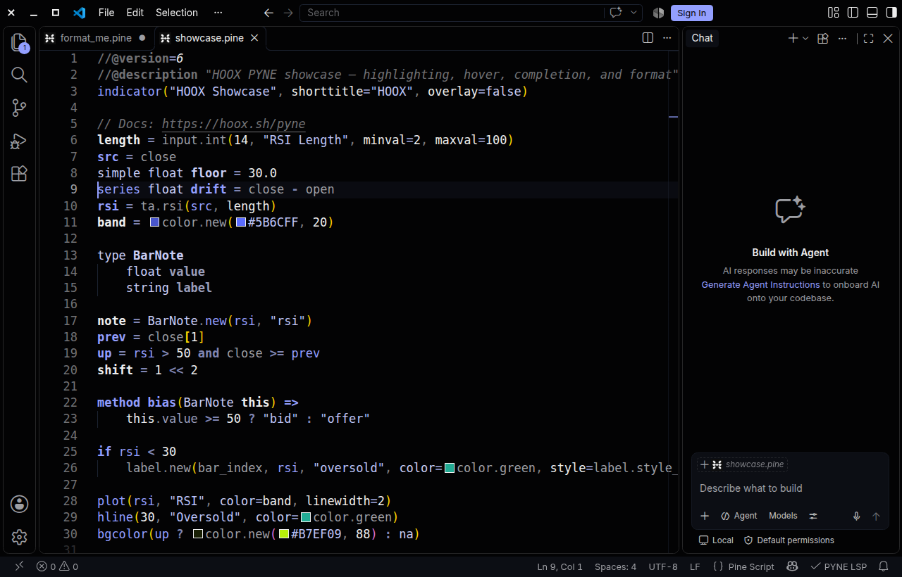

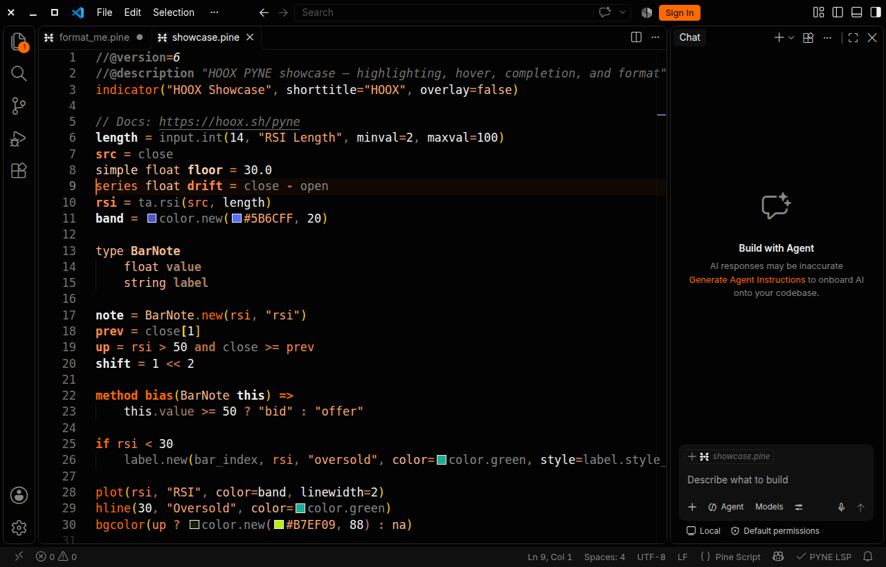

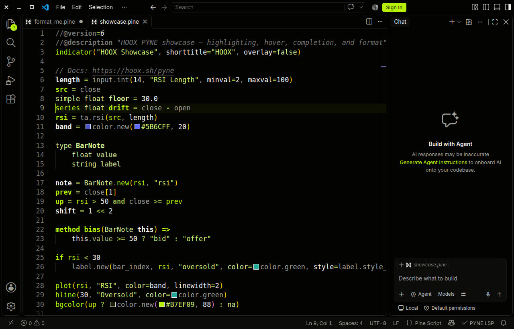

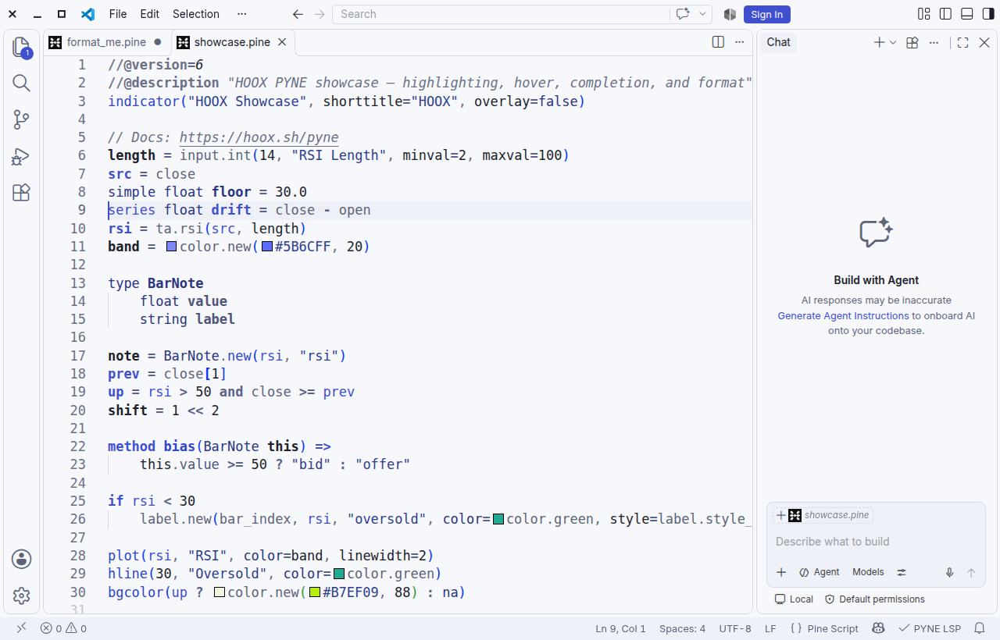

### Diagnostics

A parse error from `pyne-lsp` and the static lookahead warning on `request.security` / `lookahead_on`.

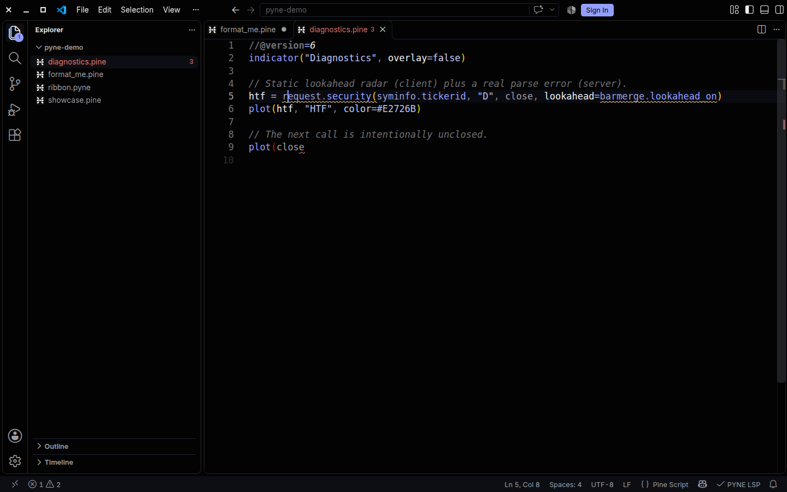

### Completion

Builtin completion after `ta.`.

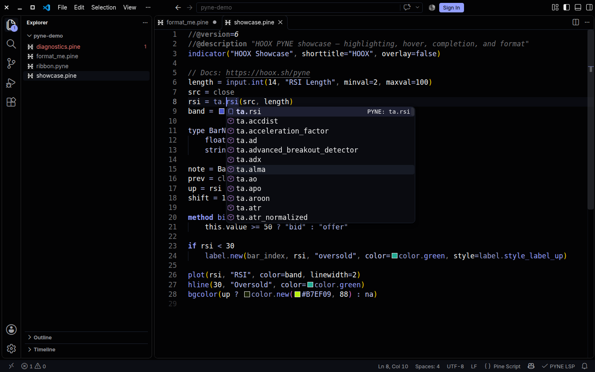

### Hover

Signature and docs for `ta.rsi`.

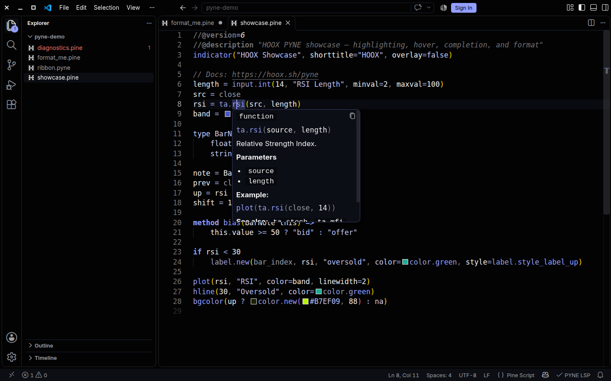

### Signature help

Parameter hints while the argument list is open.

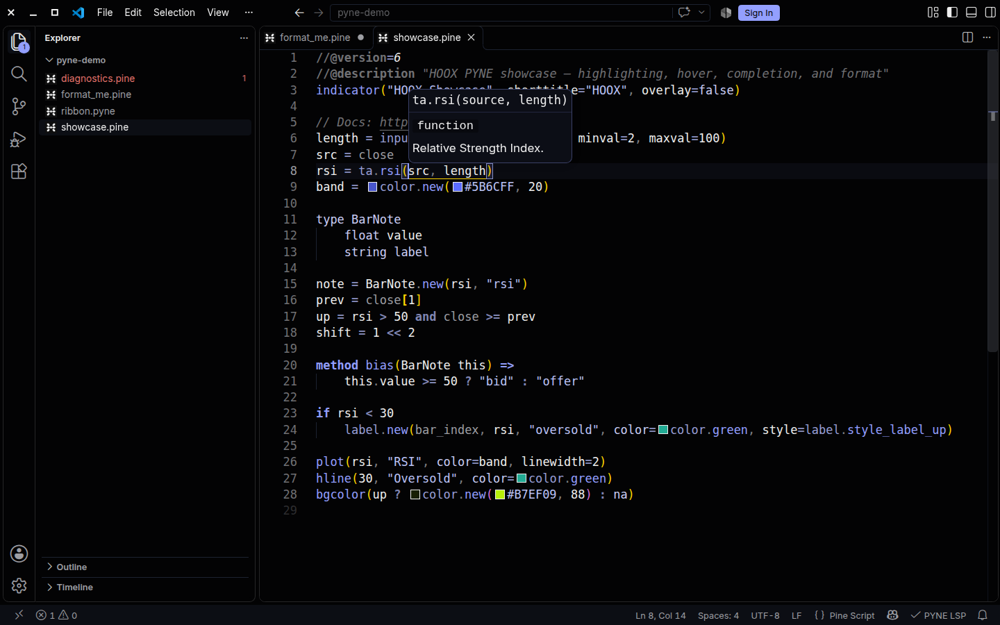

### Formatting

`PYNE: Format Document` rewrites spacing through the language server. pyne-lsp 0.6.35 and later (or any server whose initialize legend ends with `series` then `simple`) keeps line, trailing, and block comments. Older servers would drop those notes, so the client only asks them to format a comment-free buffer.

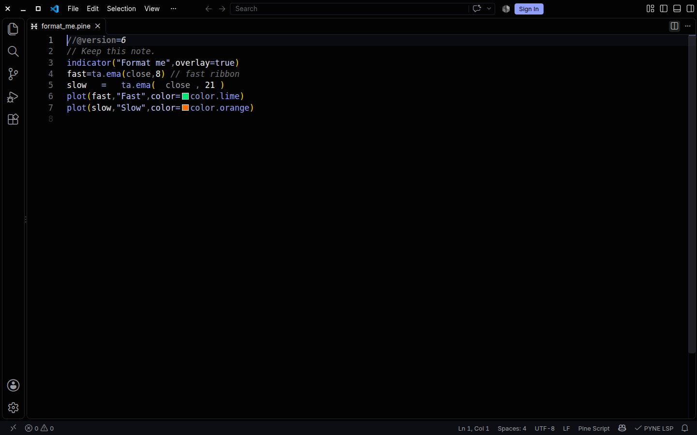

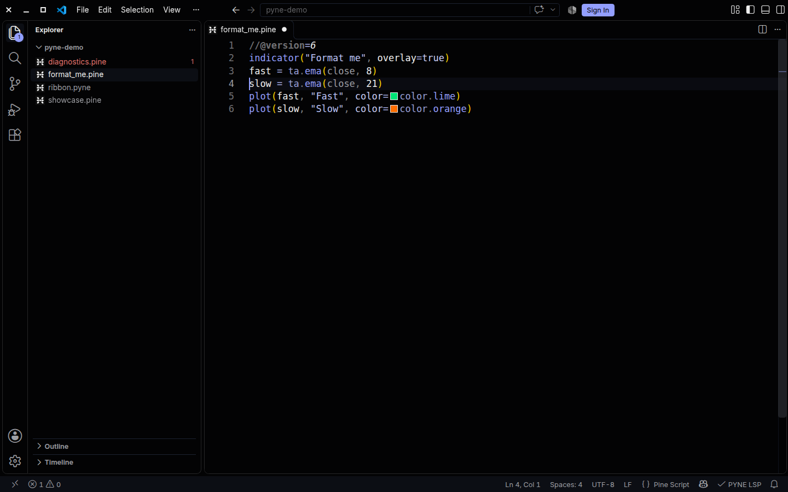

### Inlay hints

Parameter names on `ta.rsi` and `input.int` (`PYNE: Toggle Inlay Hints`, off by default).

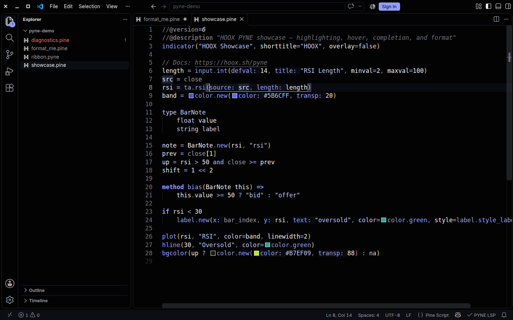

### Commands

`PYNE: Language Server Status` opens the output channel while the server is running, and an install / restart menu when it is not.

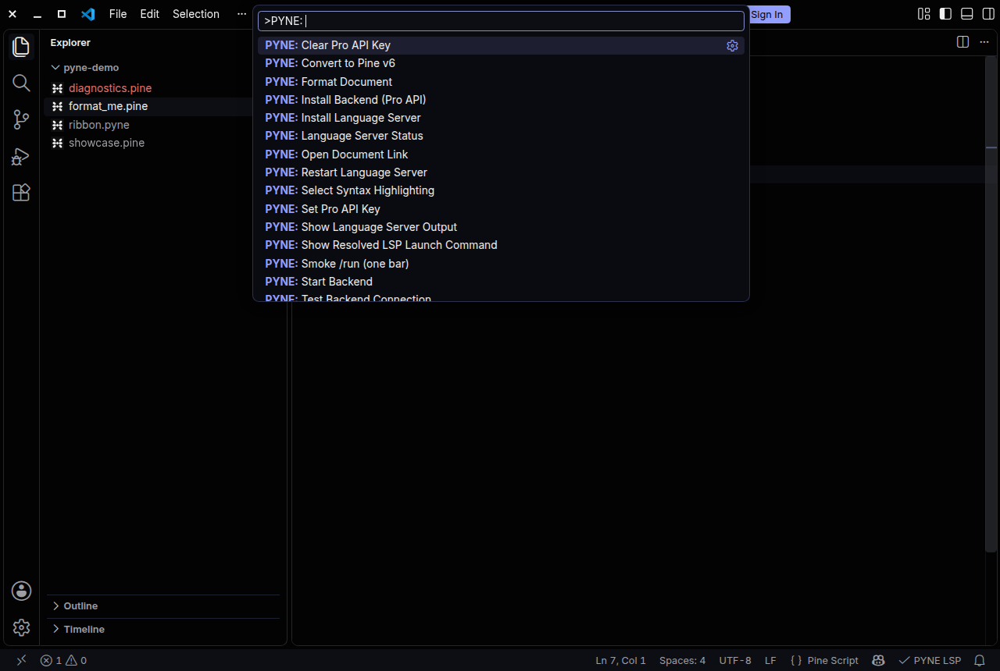

### AXIS Day

The light theme uses the same Pine scopes, with token colors darkened so they stay readable on paper.

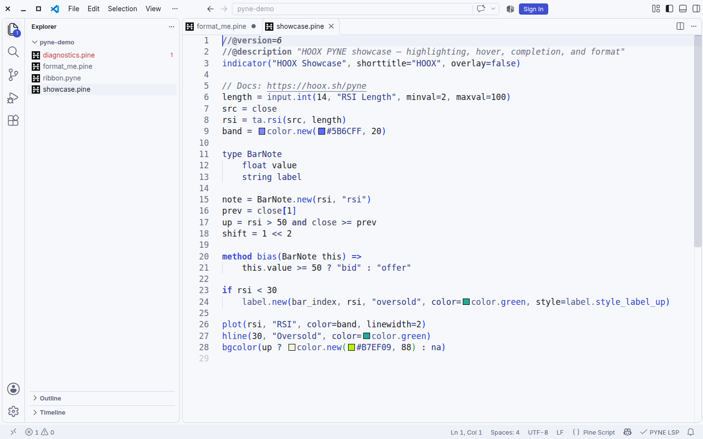

### LSP discovery order

1. `pynescript.lsp.command` if not `auto`
2. `pyne-lsp` on `PATH`
3. `pynescript-lsp` on `PATH` (backward-compatible alias)
4. `python3 -m pynescript.langserver` (requires `pip install "hoox-pyne[lsp]"`)

Full feature matrix, deployment modes, settings reference, and command list: [`FEATURES.md`](./FEATURES.md) and the [settings section below](#settings).

## Deployment modes & feature support matrix

The extension has two independent subsystems:

1. **Language server (`pyne-lsp`)** — a local stdio process spawned from your Python environment (`pip install "hoox-pyne[lsp]"`). It never calls a backend.
2. **Pro API client** — plain `fetch` calls against a configurable backend (**PYNE: Smoke /run (one bar)** → `POST /run` with one synthetic bar, **PYNE: Test Backend Connection** → `GET /health`). Chart run is **AXIS: Run Script**, not this extension.

| Mode | How | Auth |
| --- | --- | --- |
| **Hosted Pro (remote)** | `pynescript.backend.useHosted=true` → `https://pynescript.online` | Pro API key required (**PYNE: Set Pro API Key** → SecretStorage) |
| **Self-hosted local** | Flask Pro API on `http://127.0.0.1:5002` (`make run`, `make docker-up`, or **PYNE: Start Backend**) | No key for `POST /run` (free-tier endpoint); key accepted if set |
| **Self-hosted remote** | Same Flask Pro API on your own host (`pynescript.backend.url`) | Same as local (key optional; recommended if exposed) |
| **Self-hosted edge** | [`pyne-worker`](https://github.com/jango-blockchained/pyne-worker) on Cloudflare — `POST /run`, `/health`, `/scripts`, `/cron/*` | Tenant `Bearer hx_live_…` key when auth is enabled on the worker |
| **None** | No backend configured | — |

The complete per-feature matrix lives in [`FEATURES.md`](./FEATURES.md).

## Recommended: PYNE MCP for agents

Copilot agent mode, Claude Code, and Cursor can call the language tools directly through **PYNE MCP** — no backend and no Python LSP process needed:

```bash
pip install "hoox-pyne[mcp]"
pyne mcp config    # prints mcpServers JSON
```

Register `pyne-mcp` in `.vscode/mcp.json` for agent-mode tool access. See [PYNE MCP docs](https://hoox.sh/pyne/docs/enduser/guides/mcp).

## Settings

### Appearance

| Key | Default | Notes |
| --- | --- | --- |
| `pynescript.syntaxHighlighting` | `void` | Pine token palette: `none` / `void` / `signal` / `volt`. Independent of the workbench theme. |

The contributed themes (**AXIS Void**, **Hoox Signal**, **PYNE Volt**, **AXIS Day**) are selected from VS Code's own Color Theme picker; the extension never switches your workbench theme. On those themes the matching token colors come from the theme itself, so the dark default palette is not painted over AXIS Day.

### Language server

| Key | Default | Notes |
| --- | --- | --- |
| `pynescript.lsp.enabled` | `true` | Start the server for Pine files |
| `pynescript.lsp.command` | `auto` | `auto` / absolute path / `docker` |
| `pynescript.lsp.python` | `python3` | Interpreter for the `auto` fallback |
| `pynescript.lsp.args` | `[]` | Extra server args (or `docker run` args) |

### Editor features

| Key | Default | Notes |
| --- | --- | --- |
| `pynescript.formatting.enabled` | `true` | Full / range / on-type formatting |
| `pynescript.formatOnSave.enabled` | `false` | Format on save |
| `pynescript.diagnostics.enabled` | `true` | Show errors, warnings, hints |
| `pynescript.diagnostics.severity` | `{}` | Remap severity by lint-code prefix |
| `pynescript.diagnostics.style` | `false` | Show style-only findings |
| `pynescript.diagnostics.semantic` | `false` | Opt-in checks: S001 unknown member, S002 arity, S003 weak value, S004 bare `na` (S003/S004 need a `series`/`simple` server) |
| `pynescript.completion.snippets` | `true` | Snippets in autocomplete |
| `pynescript.hover.enabled` | `true` | Hover cards |
| `pynescript.inlayHints.parameters` | `false` | Parameter-name hints (opt-in) |
| `pynescript.signatureHelp.enabled` | `true` | Signature help |
| `pynescript.semanticTokens.enabled` | `true` | Semantic token colors |
| `pynescript.documentHighlight.enabled` | `true` | Highlight occurrences |
| `pynescript.linkedEditing.enabled` | `true` | Rename-as-you-type (also needs `editor.linkedEditing`) |
| `pynescript.selectionRange.enabled` | `true` | Smart expand/shrink selection |
| `pynescript.documentLink.enabled` | `true` | Clickable URLs in comments/strings |
| `pynescript.codeAction.enabled` | `true` | Convert to v6, `W001` quick fix |

### Installation

| Key | Default | Notes |
| --- | --- | --- |
| `pynescript.install.autoInstall` | `false` | Install the server silently when missing |
| `pynescript.install.autoPrompt` | `true` | Ask once when the server is missing |
| `pynescript.install.package` | `hoox-pyne[lsp]` | pip requirement to install |
| `pynescript.install.python` | `""` | Interpreter for pip / fallback launch |
| `pynescript.install.args` | `[]` | Extra pip arguments |
| `pynescript.install.createVenv` | `true` | Auto-venv for PEP 668 Python |
| `pynescript.install.venv` | `""` | Explicit venv directory |

### Pro & backend

| Key | Default | Notes |
| --- | --- | --- |
| `pynescript.pro.enabled` | `false` | Enable hosted Pro (`pynescript.online`). Local one-bar smoke does not need this |
| `pynescript.backend.url` | `http://127.0.0.1:5002` | Self-hosted base URL |
| `pynescript.backend.useHosted` | `false` | Use the hosted backend |
| `pynescript.backend.hostedUrl` | `https://pynescript.online` | Hosted base URL |
| `pynescript.backend.package` | `hoox-pyne[pro,lsp]` | pip requirement for **Install Backend** |
| `pynescript.backend.path` | `""` | PYNE checkout for **Start Backend** |

### Example — pin a venv binary

```jsonc
{
  "pynescript.lsp.command": "${workspaceFolder}/.venv/bin/pyne-lsp"
}
```

### Example — force module launch

```jsonc
{
  "pynescript.lsp.command": "auto",
  "pynescript.lsp.python": "/usr/bin/python3"
}
```

### Example — hosted PYNE Pro

```jsonc
{
  "pynescript.pro.enabled": true,
  "pynescript.backend.useHosted": true
}
```

Then run **PYNE: Set Pro API Key** (SecretStorage; never `settings.json`).

## Commands

| Command | What it does |
| --- | --- |
| **PYNE: Restart Language Server** | Kill and relaunch the server |
| **PYNE: Show Language Server Output** | Open the output channel |
| **PYNE: Show Resolved LSP Launch Command** | Print the command the extension would run |
| **PYNE: Language Server Status** | Open output when the server is up; otherwise install, restart, or show the launch command |
| **PYNE: Install Language Server** | `pip install hoox-pyne[lsp]` |
| **PYNE: Format Document** | Full-document format |
| **PYNE: Convert to Pine v6** | Rewrite the document toward v6 |
| **PYNE: Smoke /run (one bar)** | POST the buffer plus one synthetic bar to `/run` |
| **PYNE: Set Pro API Key** | Store the hosted Pro key in SecretStorage |
| **PYNE: Clear Pro API Key** | Delete the hosted Pro key from SecretStorage |
| **PYNE: Install Backend (Pro API)** | `pip install hoox-pyne[pro,lsp]` |
| **PYNE: Start Backend** | `python -m backend.app` from a checkout |
| **PYNE: Test Backend Connection** | Ping `/health` |
| **PYNE: Select Syntax Highlighting** | Choose `none` / `void` / `signal` / `volt` |
| **PYNE: Toggle …** | One toggle per feature (diagnostics, completion, hover, inlay hints, …) |

## Repository layout

```
src/                 TypeScript host (extension, lsp, config, install, backend, …)
src/test/            manifest + extension-host tests
syntaxes/            TextMate grammar
snippets/            Pine snippets
themes/              AXIS Void / Hoox Signal / PYNE Volt color themes
media/               Icons and brand header
scripts/edh.mjs      Extension Development Host launcher
examples/            Sample .pine script for the dev host
```

## Marketplace identity

| Field | Value |
| --- | --- |
| Extension id | `hoox-sh.pyne` |
| Display name | PYNE Language Support |
| Publisher | `hoox-sh` |
| License | AGPL-3.0-or-later |

## Related

- **[hoox-sh/pyne](https://github.com/hoox-sh/pyne)** — parser, runtime, CLI, `pyne-lsp`, Pro API
- **[PYNE docs](https://hoox.sh/pyne/docs)** — end-user and developer guides
- **[hoox.sh](https://hoox.sh)** — the HOOX stack

## License

AGPL-3.0-or-later. See [LICENSE](./LICENSE).
